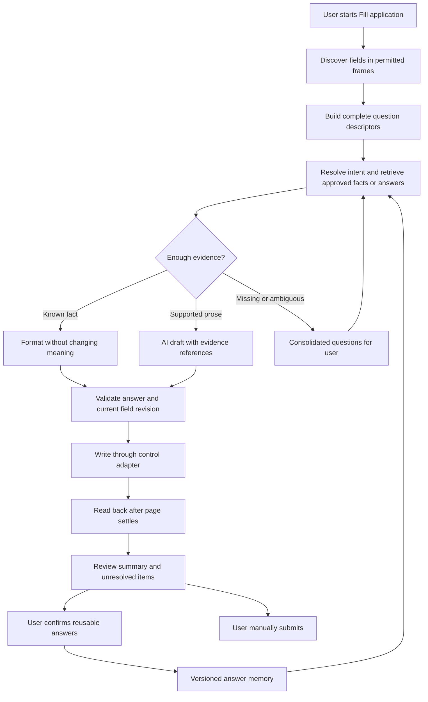

# ResumeFiler / Apply karo: accuracy and coverage redesign

Research and code audit: 7 October 2026. Status: Phases 0–6 engineering implemented and locally verified. Phase 7 release tooling and regression corpus implemented; overall coverage, live/provider and human acceptance remain open. Live ATS/provider/native-popup acceptance and human timing remain open. See the phase evidence reports.

## 1. Recommendation

Build a form-understanding and verified-answer pipeline. Every eligible field should receive a resolution decision, even if its answer is already known. Use AI for interpreting ambiguous questions, checking whether a saved answer actually applies, and drafting grounded prose. Copy known facts through deterministic formatters. This keeps names, dates, phone numbers and other exact facts consistent while spending AI requests where they improve results.

The requested workflow becomes:

1. Understand the entire question, its section, choices and constraints.
2. Look up verified profile facts and previously approved answers.
3. Reuse an answer only when its meaning and context match; adapt presentation without changing the underlying facts.
4. Otherwise retrieve relevant resume evidence and generate a supported answer.
5. If the necessary fact is missing, ask once in a consolidated panel and remember the confirmed answer at the appropriate scope.
6. Fill the correct control, verify that the value survived, and show a review summary.
7. The user reviews and manually submits.

An AI call for every name/email box would add latency and opportunities for error. A unified resolver for every field provides the intended experience without requiring an inference request for every field. A resume alone cannot establish all preferences, compensation expectations, work eligibility, availability or company-specific declarations.

**The 90% time reduction is a product acceptance target, not a result established by this audit.** Measure review and correction time as part of it. A form filled with plausible mistakes does not meet the target.

## 2. Audit scope and evidence

Inspected the current working tree, including uncommitted work, rather than assuming the README describes current behavior. No application source was edited during this audit. The existing bundle test regenerates `src/engine/bundle.js`; it was executed as part of verification. Existing source edits were preserved.

Read the detector, scanner, matching rules, answer learning, shared AI transport/prompts, single-field UI, injection, storage, frame coordination and build scripts. Graph-analysis tools were unavailable, so the dependency review used imports and direct call sites. Browser fixture files exist, but this audit did not execute a live browser, authenticate to an ATS, call a paid model, or submit an application. Exact failing URLs have not been supplied.

The user clarified two priority problems during the audit: the toolbar popup says Filling and brings up the on-page panel without completing the fill, whereas pressing Fill in that panel works; Workday is the most frustrating platform, especially skipped dropdowns. These reports drive the first implementation milestone and the browser fixture priority. They are user-observed behavior; the precise toolbar failure mechanism still needs browser reproduction.

### Existing baseline

All 11 existing Node test scripts passed: **687/687 checks**.

| Script under `test/` | Passing checks |
|---|---:|
| ai.test.mjs | 114 |
| bundle.test.mjs | 34 |
| detect.test.mjs | 43 |
| features.test.mjs | 69 |
| fixes.test.mjs | 206 |
| frames.test.mjs | 19 |
| jobmatch.test.mjs | 53 |
| match.test.mjs | 53 |
| posting.test.mjs | 32 |
| upload.test.mjs | 24 |
| values.test.mjs | 40 |

Reproduction from the repository root in PowerShell:

```powershell
Get-ChildItem test -Filter '*.test.mjs' | ForEach-Object {
    & node $_.FullName
    if ($LASTEXITCODE -ne 0) { throw "Failed: $($_.Name)" }
}
```

These are useful unit/stub checks, including AI requests with mocked fetch. They do not measure real model correctness, real ATS acceptance or user time savings. Some checks assert source strings or locally reconstructed behavior rather than exercising a complete extension session.

### Findings that explain the reported behavior

Line references are for the working tree inspected on the audit date and may move during implementation.

| ID / priority | Evidence | Consequence and required change |
|---|---|---|
| F1 / P1 | `src/engine/scan.js:234-274` chooses aria-label before aria-labelledby, sometimes takes only the first referenced label or a heading. Several paths cap question text at 100–250 characters. | A qualifier such as country, time period or sponsorship condition can disappear. Preserve full accessible-name parts and separate full question text from UI previews. |
| F2 / P1 | `src/shared/ai.js:597-648` tells the model to answer every field, infer freely, and on retry permits null only for very limited cases. This conflicts with its instruction not to invent facts. | Missing evidence becomes a guess. Introduce explicit needs-user/ambiguous states and evidence requirements. Do not retry an intentional abstention as if it were a transport failure. |
| F3 / P1 | `src/engine/index.js:1115-1121` saves short AI output through `learn()` immediately. `1255-1263` stores it as learned data or personal custom fields. `367-419` gives taught values priority over rules. | One wrong AI guess can become a persistent high-priority answer. Separate generated drafts from user-confirmed memory and quarantine old provenance-free entries. |
| F4 / P1 | `src/shared/rules.js:671-684` keys memory from label/name/id, strips non-ASCII characters and truncates to 60 characters. Section, entity, country and job are excluded. | Different questions collide; generic City or Title answers can cross sections; non-English identity is degraded. Use Unicode-preserving contextual keys plus typed semantic intents. |
| F5 / P1 | `src/shared/ai.js:454-459` converts missing confidence to 1. `src/engine/index.js:1082-1113` accepts low confidence and only changes the highlight. | Confidence is neither reliable evidence nor an execution gate. Use validated source references, extraction quality and policy gates; missing confidence must never become certainty. |
| F6 / P1 | `src/engine/inline.js:281-284` click handler closes over the original field; `549-556` refreshes `entry.field` without updating that closure. `src/engine/index.js:1158-1180` re-extracts only generic labels. | A reused DOM element may keep the earlier question for Fill with AI. Resolve the current descriptor on click and again before applying the answer. Static code finding; specific browser reproduction remains needed. |
| F7 / P1 | `src/engine/index.js:1196-1222` snapshots before the AI wait, then writes the answer without the bulk path's in-flight edit guards. It highlights the result as non-guess. | Single-field AI can overwrite an edit made during generation or apply against changed context. Require revision/value checks and consistent result states across bulk and inline actions. |
| F8 / P1 | Sensitive skipping is in `assign()` at `src/shared/rules.js:1120`. Unassigned fields enter AI at `src/engine/index.js:425-427`; candidate filtering at `1015-1019` does not enforce that policy, and later assignment uses `skipSensitive:false`. | Missing sensitive answers can reach AI despite the rule-level setting. Apply policy before every source lookup and write, including learned answers, AI and inline actions. |
| F9 / P1 | Default `gemini-2.0-flash` in `src/shared/schema.js:87`; fallback list at `src/shared/ai.js:20-22` consists of old 2.0/1.5 models. | Google's current deprecation page lists 2.0 Flash/Flash-Lite shutdown on 1 June 2026. Fix defaults and supported-model validation; do not infer the user's configured model or key is failing without a health check. |
| F10 / P2 | `src/engine/index.js:1019` caps AI candidates at 80; `1044` and `src/shared/ai.js:576` cap options at 40. `src/detect.js:247` exits outside host/URL/form-builder gates. | Long forms, options beyond the first 40 and atypical company URLs have coverage limits. Track deferred fields explicitly, use option retrieval, and improve bounded application detection. |
| F11 / P1 | `src/engine/fill.js:270-285` checks an immediately empty constrained input, then returns success after events. Combobox branches at `473-477`, `509-525` return success after click/Enter. | Existing checks are useful but not a general post-render acceptance check. A later re-render or rejected selection can invalidate the reported success. Read back canonical values and validation state after settling. |
| F12 / P2 | AI handlers at `background.js:405-416` and `448-459` use a single stored job when page context is absent; they accept even partial page context otherwise. | Parallel applications can receive stale job context or lose a richer captured description. Bind job/resume context to an application session and verify identity. |
| F13 / P2 | Native change listener at `src/engine/index.js:1304-1338` ignores non-native ARIA controls; persistence relies on later paths such as submit/pagehide. Each context saves whole learned/profile objects at `1267-1270`. | Custom-widget corrections may not be learned; independent contexts can overwrite newer data. Move typed incremental learning events to one transactional writer with prompt persistence. |
| F14 / P1 | Toolbar `popup.js:295-319` owns force-load/retry. `src/detect.js:239-240` initiates injection without replying with readiness. Worker `rf_inject` reports script injection, not an explicit engine-ready state. On-page `src/engine/index.js:1550-1552` calls local run directly, bypassing that startup path. | Source confirms different orchestration paths and no end-to-end readiness contract. A no-response message can be treated as unreachable, and popup dismissal can lose popup-owned retries. These are candidate mechanisms consistent with the reported symptom, not a proven diagnosis. Move start/ready/fill into one worker-owned job and test cold start plus popup closure. |
| F15 / P2 | Workday-relevant combobox support already exists in `src/engine/scan.js:744-770` and `src/engine/fill.js:453-525`, but uses generic option pools, approximately 1–1.2 second waits and immediate success returns; AI sees at most 40 initially available options. | More AI alone cannot fix unloaded, virtualized or uncommitted dropdown choices. Prioritize a Workday adapter with bounded searching, option identity, dependent-field scheduling and selection verification. Specific failing Workday controls remain live acceptance cases. |

F9 is supported by [Google's deprecation documentation](https://ai.google.dev/gemini-api/docs/deprecations). It is a documented configuration defect, not a live request failure observed in this audit.

### Targeted probes executed against the actual modules

- Two questions beginning “Please describe your professional experience and qualifications for” but ending Python versus Java produce the same normalized key.
- `fieldKey({label:'City', section:'personal'})` and the education-section equivalent both return `city`.
- `readAnswers('{"0":{"value":"Yes"}}', 1)` returns confidence 1 despite no confidence being supplied.
- A minimal element with `aria-labelledby="q jurisdiction"`, where q is “Are you authorized to work” and jurisdiction is “in the United States without sponsorship?”, yields only “Are you authorized to work”. This is a module probe using a mocked element, not browser acceptance evidence.

Keep these as regression cases in Phase 0. The current baseline can pass while these defects remain; increasing the existing check count alone will not establish quality.

### Assets to preserve

The extension already has substantial useful infrastructure: profile and custom answers, resume parsing, ATS attributes and rules, open-shadow-root scanning, all-frame detection and fill coordination, typed native/ARIA filling, date/phone formatting, resume-target discrimination, bounded widget waits, undo, partial AI results, provider errors and manual final submission. Refactor around these assets with compatibility wrappers. A wholesale rewrite would discard working behavior before replacements are proven.

## 3. Research and its architectural implications

**Simplify's documented behavior supports profile reuse and reviewed drafts.** Its help pages describe common fields from a profile, reuse of responses to identical unique questions, and AI essay drafts using profile/job context. They do not disclose its internal architecture or prove an AI request is made for every field. Use those product behaviors as a reference; independently validate this extension's implementation. [Autofill documentation](https://help.simplify.jobs/help/articles/2415391-using-copilot-to-autofill-applications), [essay questions](https://help.simplify.jobs/en/articles/7306766-answering-essay-questions-with-copilot).

**Question understanding must preserve accessible relationships.** Accessible-name computation includes ordered referenced labels; form meaning also depends on group and instruction context. Implement these standards as a first layer, retain conflicting visible candidates as evidence, and use bounded AI interpretation only when needed. [W3C accessible-name specification](https://www.w3.org/TR/accname-1.2/), [W3C grouping guidance](https://www.w3.org/WAI/tutorials/forms/grouping/).

**A custom dropdown is an interaction, not a string assignment.** Comboboxes have separate editing, expanded, active-option and selected-value behavior. Use adapter read/resolve/write/verify operations and choices tied to the field, including asynchronously loaded options. [W3C combobox pattern](https://www.w3.org/WAI/ARIA/apg/patterns/combobox/).

**Structured output improves the response contract, not factual truth.** Gemini and supported Groq models offer schema-constrained responses. The current generic JSON modes and permissive parser are insufficient for field identity, source validation or uncertainty handling. Always validate locally, including with schema-capable models. [Gemini structured output](https://ai.google.dev/gemini-api/docs/structured-output), [Groq structured output](https://console.groq.com/docs/structured-outputs).

**Frame access and job durability are explicit extension concerns.** Injection depends on matching frame URLs/origins and permissions; all_frames alone is not universal access. Chrome can terminate a service worker and discard its globals. Plan permitted-frame inventory, restricted-frame reporting, related-frame tests, resumable jobs and bounded work. [Content scripts](https://developer.chrome.com/docs/extensions/develop/concepts/content-scripts), [worker lifecycle](https://developer.chrome.com/docs/extensions/develop/concepts/service-workers/lifecycle), [storage API](https://developer.chrome.com/docs/extensions/reference/api/storage).

These sources inform the proposed design. None establishes a 90% time saving for this extension.

## 4. Target flow and contracts



### FieldDescriptor

Keep DOM handles in the content script. Send only serializable descriptors to the worker/model:

```text
fieldId; applicationId; tabId; frameId; documentId; formRevision
questionFull; accessibleName; visiblePrompt; helperText; labelCandidates[]
sectionPath[]; repeatGroupId; entityId; controlKind; required
options[{optionId,label,value}]; optionsComplete; currentValueRevision
constraints{min,max,step,maxLength,pattern,wordLimit,datePrecision}
extraction{sources[],quality,ambiguous,truncated}; policyCategory
```

Runtime fieldId identifies one control/question group in one document. It is not the cross-site memory key. Descriptor refresh must detect reused DOM nodes, changed labels and replaced options. Group radios/checkboxes into one question while retaining individual option identities. Associate experience and education blocks with stable profile entity IDs, not just a fragile array index.

### Candidate knowledge

Use three distinct collections behind a service-worker-owned repository:

| Collection | Contents | Trust and reuse |
|---|---|---|
| Facts | Contact details; education/employment entities; dated skills evidence; locations; explicit preferences; salary with currency/period; country-specific work authorization | Each value has source, verification status, timestamp and revision. Resume extraction creates candidates for confirmation. Explicit confirmed updates supersede earlier facts with history. |
| Approved answers | Original question, semantic intent, answer, evidence IDs, allowed adaptation, scope, dependencies, expiry and approval | Global only for genuinely global facts. Support country, employer, job, role-family and application scopes. Incompatible or stale records cannot win retrieval. |
| Evidence | Resume/document hashes, extraction spans, project stories, responsibilities, dates, achievements | Supports generated claims and review. Never promote a model's own output into evidence. |

Store preferences/settings in chrome.storage and transactional indexed records in extension-origin IndexedDB. Start retrieval with normalized exact matching, intent/entity indexes and local token ranking. Add embeddings only if a measured recall gap justifies their cost and maintenance. A remote vector database is unnecessary for one person's answer bank at this stage.

### AnswerDecision

```text
fieldId; descriptorHash; applicationId; profileRevision; resumeHash
status = resolved | draft | needs_user | blocked | deferred
source = profile | approved_memory | derived | resume_draft | user
intent; typedValue; optionIds[]; evidenceIds[]; transformations[]
missingFacts[]; reasonCodes[]; riskCategory; modelMetadata
```

No arbitrary CSS selectors or executable actions in model output. Reject unknown field/option/evidence IDs, mismatched revisions and unsupported statuses. A model-provided confidence may be logged for evaluation but never replaces validation. Use measured extraction confidence, verified-source status, retrieval compatibility and write verification to decide what happens.

### Resolution and adaptation policy

1. Apply user/site policy before retrieval. Preserve existing input and changes made while work is in flight.
2. Resolve exact verified facts using field intent, entity and scope.
3. Retrieve compatible approved answers; filter scope, polarity, units, validity and profile revision before semantic ranking.
4. For an ambiguous match, AI compares the question with a small candidate list and returns intent/source IDs or no-match. Similarity alone cannot authorize reuse.
5. Format facts locally; calculate only derivations with explicit rules and known inputs.
6. Draft prose using selected evidence and session-bound job information. Check the drafted claims against the referenced evidence; reject unknown references and flag unsupported claims. Source-ID existence alone is insufficient grounding.
7. Present unresolved facts together. Confirm once, store at the chosen scope, and retry only dependent fields.

Examples of safe versus unsafe adaptation:

| New question | Desired behavior |
|---|---|
| Telephone with separate country-code field | Reformat the verified phone number; do not add the prefix twice. |
| “Will you require sponsorship?” versus “Can you work without sponsorship?” | Resolve polarity from explicit country-specific facts; never reuse a bare Yes by text similarity. |
| Current salary versus expected salary; annual INR versus monthly USD | Different intents/units. Do not convert or infer preferences silently. |
| Years of professional experience with Python | Use dated qualifying experience and overlap rules. Total career tenure or a Python skill mention is insufficient. |
| City in an education block | Use the selected education entity's city, not the candidate's home city. |
| Why this company? | Reuse approved project/story evidence but generate for the current company and role. Never replay another employer's paragraph. |
| Gender/disability/consent or declaration | Use only explicit user-provided answers under the configured policy. No inference from name/resume and no silent default acceptance. |

## 5. Phased implementation plan

Implementation checkboxes are updated only against evidence. Phase 0 evidence is recorded in `docs/evidence/phase0/REPORT.md`; live and human acceptance remains open. Durations are rough focused engineering effort for one engineer, excluding scheduling of live user trials; they are planning estimates, not commitments.

### Phase 0 — Establish a quality baseline (2–3 days)

**Purpose:** distinguish missed detection, wrong question, wrong answer, wrong option and failed write.

- [x] Add regression probes for F1–F8, F10–F15 using synthetic personal data. Known failures remain red against desired contracts; fixture results capture question, mapping, answer and write failures.
- [x] Add toolbar cold/warm and on-page scenarios, delayed injection, popup-tab closure, missing frame replies, provider delay and repeated starts, plus Workday dropdown simulations. Native browser-action dismissal remains a separate live acceptance check.
- [x] Introduce field-level outcome vocabulary and observations. `verified` is reserved for the replay oracle; production observations do not infer correctness or user review.
- [x] Add opt-in, redacted local diagnostics, export and immediate clearing on opt-out. Extractor signal is a candidate source, not a claim about the exact extraction branch.
- [x] Build 20 structural form variants / 500 labeled observations from 25 authored intent rows, including repeated employment groups. Every eligible gold field remains in the denominator.
- [x] Split tuning from held-out templates/paraphrases and add 10 negative pairs. Future release acceptance needs a fresh sealed holdout to avoid repeated-test leakage.
- [ ] Capture baseline manual and assisted timing on matched forms once representative user examples are available.

**Files:** extend existing `test/` suites; add `test/fixtures/autofill/`, `test/eval/`, and `src/engine/diagnostics.js`. Keep core behavior changes out of baseline measurement commits.

**Gate:** failures are reproducible and attributable to a stage; evaluation emits counts and per-family metrics. Current 687 checks remain runnable. User time and live-browser baselines remain explicitly unverified until measured.

### Phase 1 — Fix toolbar execution and stop wrong answers becoming trusted data (3–5 days)

**Depends on:** Phase 0 regression cases.

- [x] Give toolbar, shortcut and on-page panel one `startFill(tabId)` command returning a runId promptly. The worker owns engine preparation, readiness acknowledgements, retries and progress; popup and panel only subscribe/render.
- [x] Add an explicit per-document engine-ready handshake. `rf_force_load` must acknowledge accepted/ready/error states; a mounted panel is not evidence that the requested fill ran. Surface missing content script, injection failure, no fields, timeout and model failure separately.
- [x] Persist minimal job state/progress and deduplicate start requests per tab/document. Popup closure/reopen must resume observing the same job. Worker restart must recover/reconcile safely without duplicate writes; reject stale frame results.
- [x] Always report completion or failure for each claimed frame, including thrown/rejected runs; clear UI busy states through finally paths. Show Preparing page, Detecting, Filling, Waiting for AI, Verifying and Completed/Needs attention rather than an unexplained spinner.
- [x] Remove contradictory forced-answer retries. Require a supported answer or a typed unresolved reason.
- [x] Stop automatic promotion of AI output into approved memory. Mark existing learned/custom entries with unknown provenance as legacy-unverified; preserve data for review/export.
- [x] Apply a single answer policy to rules, learned answers, bulk AI and inline AI; close the sensitive-field bypass.
- [x] Reject missing/out-of-range confidence as a certainty signal; use explicit evidence/status instead.
- [x] Fix inline overlay closure and re-resolve the question at click time. Add document, descriptor and current-value revision checks before writing or undoing delayed answers.
- [x] Validate provider/model configuration against current supported capabilities; update obsolete defaults, preserve explicit user settings with a clear migration notice, and expose actionable health errors. Do not run fallback chains of retired models.
- [x] Route bulk and inline requests through the same validation facade; retain BYOK and manual submission.

**Files:** `popup.js`, `src/detect.js`, `src/shared/ai.js`, `src/engine/index.js`, `src/engine/inline.js`, `src/shared/schema.js`, `background.js`; introduce `src/shared/answer-policy.js`, a minimal `src/engine/session.js` contract and targeted tests.

**Gate:** one toolbar click and one on-page click produce equivalent verified results on the same cold/warm fixture state; closing/reopening the popup does not cancel execution; delayed startup cannot leave a permanent Filling state. No unapproved AI answer enters trusted memory; unknown eligibility facts stay unresolved; inline generation cannot overwrite in-flight user edits; retired defaults are absent from release configuration. Provider availability is tested with synthetic data before release, separately from mocked transport tests.

**User outcome:** fewer confidently wrong answers immediately. Some fields may become visibly unresolved until the knowledge phases supply their facts.

**Engineering evidence:** [Phase 1 report](evidence/phase1/REPORT.md). 760 unit assertions, 23 scoped extension-browser cases and two actual worker-termination cases passed. The Verifying stage checks remaining fields; general post-render write verification is still Phase 5.

- [ ] Release acceptance: real provider responses, native toolbar popup/focus/dismissal, live Workday/other ATS pages, restricted-frame behavior and user timing. Synthetic provider mocks do not satisfy this gate.

### Phase 2 — Reconstruct complete questions and tackle Workday dropdowns (5–7 days)

**Depends on:** Phase 0; ship after Phase 1 safety gates.

- [x] Extract descriptor building from scan.js: accessible names, ordered aria-labelledby references, visible question, legend/group, descriptions, section and repeated entity.
- [x] Keep complete question text; preserve full questions and known option sets in model inputs. Large inputs affect batching rather than silently dropping qualifiers.
- [x] Store label candidates/provenance; flag conflicting labels or generic prompts for targeted interpretation.
- [x] Add bounded discovery on unfamiliar application pages, retaining explicit manual activation. Negative login, search and checkout fixtures pass.
- [x] Inventory ready frames/open roots and warn about recognizable uninspectable components or missing frame URLs. Manual all-frame about:blank/srcdoc fixtures pass without manifest changes. This is partial inventory, not universal closed-root or restricted-origin detection; live restricted/related-frame acceptance stays open.
- [x] Make SPA descriptors and conditional-section scanning revision-aware. Replace the 80-field cutoff with a bounded queue and visible deferred count; another manual pass resumes through fresh discovery after quota/cancellation.
- [x] Provide “Correct detected question” in prose-field popovers; scope locator fixes to the application URL and original question. Expansion to every control UI remains future work.
- [x] Implement the early Workday adapter against reproduced button, search, portal, virtualized, hierarchical, dependent and multi-select fixtures, including repeated-section identity. Live employer templates remain acceptance work.

**Workday dropdown algorithm:** classify native select versus searchable/button combobox; read the complete question and expected value type; open its owned menu; wait for a usable option set or loading-state change; search with a canonical value/approved alias where supported; inspect additional virtualized options with bounded scrolling if needed; rank exact typed equality, then approved vocabulary mappings, then constrained semantic matches. Choose only a supported option with a clear winning match. If two plausible choices remain, show both in the review panel. Click the option, wait for the selected label/chip/canonical value, verify it persists, then rescan dependent questions. An input displaying typed search text is not a selected option.

For example, a confirmed B.Tech can map to Bachelor's degree through a curated degree-level mapping; a desired salary must match the correct currency and range; a bare Yes cannot select an option until the question's polarity is resolved. If no compatible option exists, report it explicitly rather than selecting an unrelated “closest” answer.

**Files:** `src/detect.js`, `src/engine/scan.js`, `src/engine/fill.js`, frame handlers in `background.js`; new `src/engine/discovery/{labels,descriptor,queue}.js`, `src/shared/field-identity.js`, `src/engine/controls/workday.js` and fixtures. Phase 2 does not change manifest permissions.

**Gate:** >=98% eligible-field recall and >=99% full-question semantic fidelity on the held-out supported-template corpus, reported separately by family. These scoped local gates pass; [Phase 2 evidence](evidence/phase2/REPORT.md) records the measurements and widget outcomes. The question metric compares authored full text and is not a live semantic-interpretation benchmark. Full overall accuracy, general delayed write verification and custom-widget correction learning remain open.

### Phase 3 — Build verified facts and scoped answer memory (4–6 days)

**Depends on:** Phase 1 provenance policy and Phase 2 descriptors.

- [x] Add versioned Fact, Evidence and ApprovedAnswer records with entity IDs, timestamps, available source spans, scopes, expiry and dependency revisions. Entity changes conservatively invalidate answers; full semantic entity reconciliation remains later resolver work.
- [x] Extract resumes into proposed facts and source project/story spans, with selected-fact confirmation and visible profile conflicts. Unsupported normalized facts have no invented source span.
- [x] Add “Ask once” for address, location preferences, notice/availability, compensation units, country-specific authorization and disclosure preference. Contact facts and simple scoped authorization have early integration; generalized formatting/resolution remains Phase 4.
- [x] Implement Unicode exact and lexical retrieval preserving original questions/context. Only exact matches write automatically; critical/negative questions exclude approximate candidates.
- [x] Centralize incremental correction/profile writes in the worker with IndexedDB transactions and revision checks. Content pages no longer save stale profile/answer snapshots. Recover interrupted compatibility projections without overwriting newer profile edits.
- [x] Migrate legacy records idempotently into a separate unverified namespace, preserve the original backup, and support export/delete/undo. Imported answers require explicit review; originals remain available.
- [x] Invalidate answers on profile/resume/stored-job changes and visible application identity changes. Time-dependent setup facts have as-of dates and a 90-day refresh policy.

**Files:** `src/shared/schema.js`, options UI, background message handlers; new `src/knowledge/{repository,migrate,retrieve,facts}.js`.

**Gate:** no cross-country/company/entity/polarity reuse in the adversarial suite; migration is repeatable and recoverable; concurrent corrections do not lose updates; resume changes invalidate dependent drafts. Every approved record has provenance and an explicit scope.

**Engineering evidence:** [Phase 3 report](evidence/phase3/REPORT.md). Scoped memory/storage gates are locally verified. Existing profile-rule compatibility, live extraction quality, semantic cross-site reuse, consolidated missing-fact prompts and custom-widget learning remain distinct later-phase/acceptance work.

### Phase 4 — Implement the shared AI-assisted resolver (4–6 days)

**Depends on:** Phases 2–3.

- [x] Give every descriptor a decision through one resolver; rules become candidate intent/fact mappings rather than immediate unreviewed writes.
- [x] Add structured schemas for question interpretation, memory comparison and grounded drafting. Use stable IDs throughout; retire label/array-position guesses in the new protocol.
- [x] Batch ambiguous questions with shared section/job context. Give AI a small compatible candidate set and relevant evidence, not the entire answer database for each field.
- [x] Permit only evidence-preserving transformations: casing/format/length for facts; grounded rewriting for prose. Enforce negation, jurisdiction, currency, periods and temporal scope in code.
- [x] Verify evidence supports the requested claim; flag unsupported prose for review and abstain on missing factual answers.
- [x] Represent closed choices with option IDs. Retrieve/search large or lazy option sets; record incomplete availability instead of taking the first 40 as exhaustive.
- [x] Key answer caches by question/option/context hashes, profile revision, resume hash, model and prompt version. Expire changes that affect meaning.
- [x] Use bounded retries for network/schema failures only. Add per-run latency/token budgets, cancellation, partial progress and provider capability tests.

**Files:** split `src/shared/ai.js` into `src/ai/{transport,schemas,interpret,draft}.js`; new `src/resolver/{resolve,validate,format}.js`; both background AI handlers use the same facade.

**Gate:** >=99% precision for factual answers approved for automatic writing on held-out data, with coverage reported alongside precision. No unsupported eligibility or sensitive facts in the safety corpus. Exact fact reuse requires zero model requests. Prose quality is evaluated for grounding, relevance and necessary-edit rate with human review, not only a model grading itself.

**Engineering evidence:** [Phase 4 report](evidence/phase4/REPORT.md). The existing held-out structural fixtures approve 142/142 correct factual decisions (100% precision) at 71.7% answerable coverage. Exact facts use zero provider requests. Semantic memory is limited to the approved application context and prose drafts; arbitrary factual transformations abstain. Resume drafts use extractive source claims with optional name-to-I substitution. Current resume text must be extracted or pasted in the dashboard. Live provider/ATS acceptance and the human grounding, relevance, edit-rate and 90% timing gates remain unchecked; see the [human worksheet](evidence/phase4/HUMAN_REVIEW.md).

### Phase 5 — Verify filling and handle dynamic workflows (4–7 days)

**Depends on:** Phase 2 descriptors and Phase 4 decisions.

- [x] Define control adapters with read, resolveOptions, write, verify and undo operations. Reuse existing native setters/date/phone helpers behind the adapters.
- [x] Verify canonical values after blur/re-render settling and inspect applicable validation state. Distinguish write attempted, DOM accepted and validation passed; browser verification does not prove server submission acceptance.
- [x] Cover native selects, radios, checkbox groups, multi-select chips, rich text, async search dropdowns, date parts and file-upload completion/error indicators.
- [x] Complete and harden the Workday adapter started in Phase 2 first, then address measured gaps on Greenhouse/Lever/Ashby and Google Forms. Include multiple Workday employer templates; do not infer platform-wide support from one employer.
- [x] Build a dependency queue: country before region, school search before degree details, checkbox-triggered follow-ups after the controlling answer. Rescan only affected groups.
- [x] Match repeated employment/education sections to stable entities. Add missing repeat blocks only through recognized non-submit controls, with bounds and reversible bookkeeping.
- [x] Protect user edits and stale nodes throughout the run; snapshot immediately before accepted writes and do not undo over later user edits.
- [x] Preserve guarded multi-step behavior. Never use an unconstrained model to choose/click navigation or submit controls; stop at uncertain/final steps.

**Files:** extract `src/engine/fill.js` into `src/engine/controls/` adapters; add `src/engine/session.js`, `src/engine/verify.js`; update `steps.js`, orchestration and frame messages.

**Gate:** >=99% verified write success for attempted supported controls in browser fixtures; zero writes to stale or user-edited fields and zero auto-submissions. Include delayed re-render, async rejection, portal dropdown, nested frame, dependent field and worker-restart tests.

**Engineering evidence:** [Phase 5 report](evidence/phase5/REPORT.md). The common verifier passes 22/22 explicitly supported control attempts plus separate delayed-rejection, stale/user-edit, nested-frame, repeat and navigation checks. The bounded observation window and final readback establish local DOM/validation evidence, not server acceptance. Repeat expansion is limited to recognized Workday-style controls; ambiguous entities and unsupported Clear/undo controls stay manual. Two different synthetic Workday-style triggers are tested, while multiple live employers, real ATS acceptance and 90% review-plus-correction timing remain open. The older broad low-level corpus and F13 learning failure remain separately recorded.

### Phase 6 — Make review fast and learning reliable (3–5 days)

**Depends on:** Phases 3–5; early review states can ship during Phase 1.

- [x] Replace a single filled count with Verified facts, Drafts to review, Missing facts and Could not fill views. Show all eligible fields, including deferred/unsupported ones.
- [x] Show each question, answer, source, transformation and reason for uncertainty; selecting a row focuses/highlights its control.
- [x] Collect repeated missing facts once and refresh all dependent answers. Permit batch confirmation of facts and reviewed drafts while leaving final submission manual.
- [x] Separate “Use for this application” from “Remember for similar questions”; suggest scope from the typed intent. Company-specific answers default to application/employer scope.
- [x] Capture trusted corrections for native and custom controls through adapter readback. Track extension-authored writes so they are never mistaken for user approval.
- [x] Feed correction events into mapping repair, fact updates or answer replacement as appropriate. Do not demote an intent just because the user changed their phone number.
- [x] Provide source-level undo, memory search/edit/delete and a report-issue export with user-controlled redaction.

**Files:** `src/engine/panel.js`, `src/engine/inline.js`, popup and options UI; new `src/engine/review.js`, `src/knowledge/learning.js`.

**Gate:** a corrected answer is reused on an equivalent question and withheld on a near-match with different meaning. Review lists explain every unresolved field; custom-widget edits persist correctly. A usability trial measures review time and whether users notice intentionally seeded errors.

**Engineering evidence:** [Phase 6 report](evidence/phase6/REPORT.md). Scoped correction reuse, meaning-changing abstention, custom-widget persistence, per-field review, source undo, consolidated missing answers, memory management and redacted export have local engineering checks. Wider reuse is restricted to literal personal questions; employer-specific answers default to application scope.

- [ ] Human usability trial: measure review time and detection of intentionally seeded errors using [the worksheet](evidence/phase6/USABILITY_TRIAL.md). Live ATS/provider acceptance and the 90% time-saving target remain open.

### Phase 7 — Prove the target and release incrementally (4–6 days plus user trials)

**Depends on:** all quality gates above.

- [x] Run the built extension in real Chromium integration tests and packaged smoke tests. Verify packaging includes new modules and generated bundle matches source.
- [ ] Run live provider checks using synthetic profiles to confirm configured model availability, schemas, timeouts and partial results. Do not transmit the user's resume merely to benchmark models.
- [x] Expand to at least 40 held-out form variants / 1,000 labeled questions, with dynamic controls, restricted surfaces, malicious question text and adversarial memory pairs.
- [ ] Run at least 30 representative, paired manual/assisted application-form trials across the user's main platforms. Use matched variants/counterbalanced order to reduce practice bias; no automatic submission is needed.
- [ ] Publish p50/p90 task time, per-family coverage/precision, unresolved rate, correction rate, false-success count, cost and retry rate. Report unsupported forms separately and include them in the overall user-workload result.
- [x] Introduce feature flags for descriptor/resolver/adapter changes, staged rollout, local failure diagnostics and rollback. The old unsafe learning/prompt behavior must not return as a fallback.

**Gate:** demonstrate >=90% aggregate time reduction on the agreed representative workload, with required correctness gates satisfied. Report median and tail performance and sample uncertainty; if the overall target is missed, report the measured saving and remaining bottlenecks. Do not relabel a narrower successful subset as universal support.

**Release commands:** existing `node bundle.mjs`, existing test scripts, then `node build.mjs`, plus the new browser/evaluation runners introduced by these phases. The project now declares npm test/evaluation scripts and pins Playwright in package.json. Phase 7 adds packaged evaluation, live probes, recorder checks and paired-trial measurement scripts.

**Engineering evidence:** [Phase 7 report](evidence/phase7/REPORT.md). The package is tested from extracted ZIP bytes against 42 synthetic variants / 1,260 labeled observations. Supported and overall metrics stay separate; inaccessible forms remain in the overall denominator. The overall 95% coverage gate remains failed, and the runner preserves a failing exit code. No live provider or human timing result is invented.

- [x] Implement a bounded synthetic provider probe and paired-trial recorder/analysis.
- [ ] Complete live configured-provider checks and the agreed 10 Workday / 10 Keka / 10 other paired trials.
- [ ] Clear the overall coverage and 90% active-time saving release gates.

## 6. Measuring the 90% objective

Define per-trial T_manual as active time to complete and review a form manually, and T_assisted as active time to initiate autofill, answer missing facts, correct mistakes and review the completed form. Also report elapsed wall time, including model wait. Use comparable form variants and the same user/profile maturity.

```text
aggregate active-time saving = 1 - sum(T_assisted) / sum(T_manual)
example target: 10 minutes manually -> at most 1 minute assisted
```

Report initial profile setup separately and also amortize it over the first 10/30 applications. Track cold-start and mature-memory results independently. User time spent correcting facts is never excluded to improve the metric. Login/CAPTCHA/mandatory identity checks should be reported as external steps, with end-to-end elapsed time shown as well.

| Metric | Definition | Proposed gate |
|---|---|---|
| Discovery recall | Correctly discovered eligible questions / all eligible questions labeled by a human | >=98% on supported held-out templates |
| Question fidelity | Extracted questions retaining required meaning/qualifiers / discovered questions | >=99% |
| Automatic factual precision | Correct factual writes / all factual writes made automatically | >=99%; zero critical factual errors in release corpus |
| Answerable coverage | Correctly resolved known-answer fields / all eligible fields with verified available facts | >=95%, reported separately from unknown facts |
| Write success | Accepted canonical values after settling / attempted supported writes | >=99% |
| Abstention quality | Missing/ambiguous facts handled explicitly instead of guessed | 100% on critical safety corpus |
| Correction burden | Fields requiring substantive corrections / automatically filled fields | <=1% factual target; track prose separately |
| Manual effort | Active time including review/corrections versus matched manual baseline | >=90% aggregate saving target |
| Submission boundary | Automatic final submissions | 0 |

Set latency and cost budgets after Phase 0 measures normal workload sizes; provisional experience targets are useful verified factual results within 2 seconds and a typical 30-field first draft within 20 seconds on a healthy provider. Report p50/p95 and permit partial useful results if AI is slow. These are proposed budgets, not present performance claims.

## 7. Module boundaries and migration

Keep JavaScript and the existing extension runtime initially. A TypeScript conversion, hosted backend or new UI framework is not necessary to fix the reported failure modes.

| Boundary / proposed modules | Responsibility | Approximate per-file budget |
|---|---|---:|
| discovery: labels, descriptor, identity | Read page semantics and issue versioned descriptors | 150–350 lines |
| knowledge: repository, migrate, facts, retrieve, learning | Store verified knowledge and select compatible records | 150–350 |
| resolver: resolve, validate, format | Choose supported answers and enforce meaning/type constraints | 150–350 |
| ai: transport, schemas, interpret, draft | Call configured providers through validated task contracts | 150–350 |
| controls: native, choices, combobox, date, upload | Execute bounded writes and expose canonical state | 150–350 |
| session, verify, review, diagnostics | Coordinate revisions, readback and user review | 150–350 |
| existing index.js and background.js facades | Dispatch and compose these modules | Target <=400 each after migration |

Budgets are cohesion guidelines, with a soft 500-line review threshold for new modules, not release blockers by themselves. Prefer small explicit exports: buildDescriptors, resolveAnswers, validateDecision, repository queries/mutations, and adapter operations. Discovery cannot call AI/storage; provider code cannot access the DOM; knowledge code cannot write form controls. Session orchestration connects them through typed plain-object contracts. UI uses the same resolver as bulk filling.

Migration order: add characterization/regression cases → introduce contracts behind existing exports → stop unsafe behavior → improve descriptors → migrate knowledge → shadow-evaluate the new resolver without duplicate writes → switch one control/template family at a time → verify packaged behavior → remove obsolete paths. New browser tests use synthetic data. Each stage records evidence and can disable the new feature without restoring unsafe guessing or learning.

Storage rollback uses a preserved legacy snapshot and explicit schema-version readers. Keep new records in a separate namespace until migration acceptance. After cutover, rolling back code must not overwrite newer approved facts with the old snapshot. Export/recovery paths must work independently of the feature flag.

### Risks to include in the work, not defer until release

- Untrusted page/question text may contain instructions. Treat it as data in prompts; give the model no navigation, submission, storage or network tools. Validate allowed IDs/actions before any write.
- Facts and resumes contain personal data. Send only the evidence required by a task, keep keys out of content-script payloads, validate worker message senders, and exclude keys/raw values from diagnostics. Retain BYOK and explicit data export/delete controls.
- A field can be technically filled but semantically wrong. Keep interpretation, factual validation and control readback as separate gates.
- A model can cite an unrelated valid evidence ID. Check claim support, units and context, and include unsupported-claim examples in evaluation.
- Memorized answers become stale. Track dependent fact revisions, time context and country/job scope; expire or re-ask when needed.
- Some widgets/frames cannot be accessed through ordinary extension APIs. Report the limitation with a copy-ready answer and include the remaining user effort in measurements.

## 8. Delivery order and completion tracking

First deliverable: Phase 0 plus Phase 1, fixing toolbar/on-page execution parity and the currently observed mechanisms behind wrong answers. Next deliverable: complete question extraction and early Workday dropdown support, followed by verified memory. Then unify resolution, harden Workday and other complex controls, and optimize review based on measured time.

Estimated total: roughly **29–45 focused engineering days**, plus live user-trial scheduling. A narrow first release can ship earlier; broad ATS coverage and a defensible 90% claim need the later phases. These estimates should be revised after the fixture baseline and actual failing pages are available.

- [x] Inspect current source and existing test coverage.
- [x] Execute existing 11-script / 687-check baseline.
- [x] Reproduce four targeted module-level defects.
- [x] Research primary product, browser, accessibility and provider documentation.
- [x] Produce architecture, migration sequence, detailed tasks and acceptance gates.
- [x] Implement Phase 0 quality harness and permanent regression probes. Human timing and native/live acceptance remain unchecked above.
- [x] Implement Phase 1 wrong-answer containment; local evidence recorded, live acceptance remains open.
- [x] Implement Phase 2 question extraction, contextual identity and early Workday controls; scoped local evidence recorded, live acceptance remains open.
- [x] Implement Phase 3 verified knowledge and scoped memory; local evidence recorded, live acceptance remains open.
- [x] Implement Phase 4 shared resolver; local evidence recorded, live acceptance remains open.
- [x] Implement Phase 5 verified writes and dynamic workflows; local evidence recorded, live acceptance remains open.
- [x] Implement Phase 6 review and correction learning; local evidence recorded, human usability remains open.
- [ ] Complete Phase 7 live/browser/provider/user acceptance.
- [ ] Demonstrate the 90% time-reduction target with measured evidence.

Every completed phase should append: commit/revision, exact commands, corpus version, metric output path, representative browser evidence and remaining live/manual limitations. Passing synthetic tests alone does not close live ATS or user-time acceptance.
